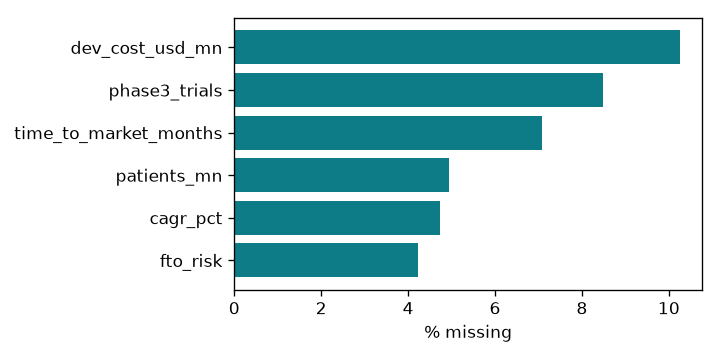
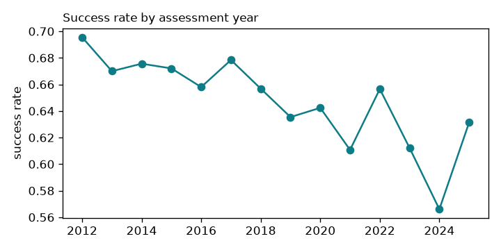
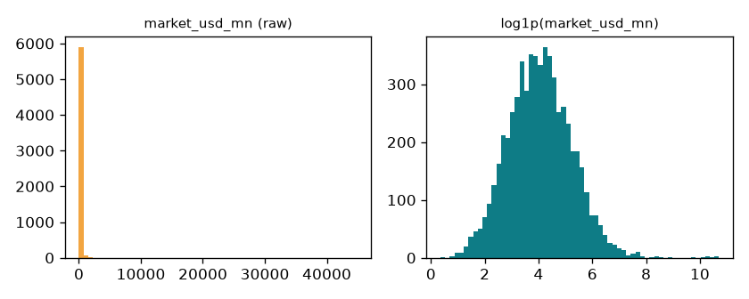
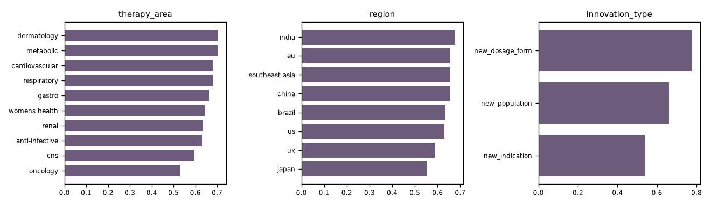
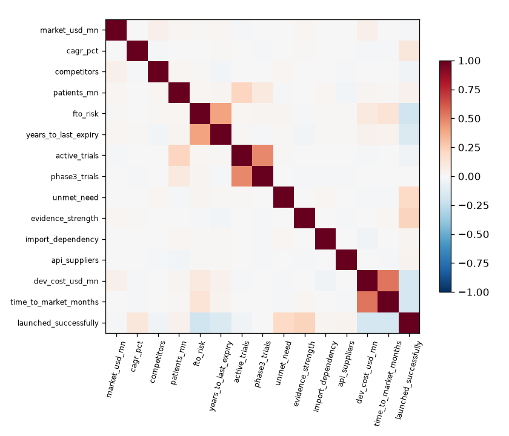
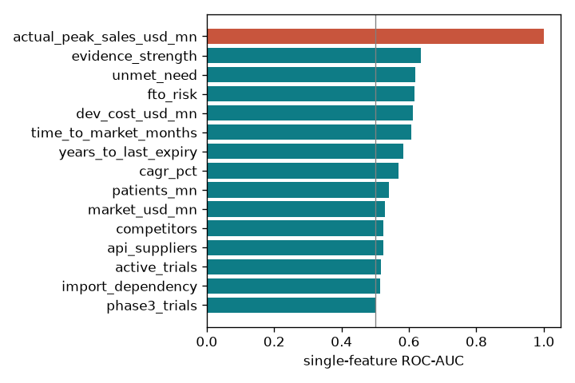

# Exploratory data analysis: repurposing_projects

## 1. Shape and data quality
- Rows: **6,090**; columns: **22**; duplicate `project_id` exports: **90**
- Positive rate (`launched_successfully`): **64.7%**, mildly imbalanced, so we stratify and report PR-AUC

### Missingness
|  | missing_% |
|---|---|
| dev_cost_usd_mn | 10.25 |
| phase3_trials | 8.49 |
| time_to_market_months | 7.09 |
| patients_mn | 4.93 |
| cagr_pct | 4.73 |
| fto_risk | 4.22 |

### Rule violations found
| check | rows |
|---|---|
| competitors == -1 (unknown sentinel) | 61 |
| |cagr_pct| > 100 (basis-point typo) | 23 |
| market_usd_mn > 50,000 (USD vs USD mn) | 16 |
| probabilities outside [0,1] | 24 |
| upper-case therapy_area variants | 753 |

### Missingness mechanism
- `patients_mn` missing rate: 24.8% when market < $20M vs 0.0% otherwise. Missingness depends on market size, so the pipeline adds **missing-indicator features** instead of silently imputing.

## 2. Target over time
Success rate falls from 68.0% (first 3 years) to 60.3% (last 3 years). This is **temporal drift**, so the test set is **out-of-time** (assessments from 2023 on) rather than a random split.

## 3. Numeric distributions
|  | count | mean | std | min | 25% | 50% | 75% | max |
|---|---|---|---|---|---|---|---|---|
| market_usd_mn | 6000.000 | 159.603 | 1207.957 | 0.430 | 24.875 | 55.355 | 124.575 | 44930.000 |
| cagr_pct | 5713.000 | 6.951 | 4.524 | -20.000 | 3.870 | 6.910 | 9.950 | 24.650 |
| competitors | 5939.000 | 12.405 | 5.993 | 1.000 | 8.000 | 11.000 | 15.000 | 41.000 |
| patients_mn | 5705.000 | 4.267 | 11.630 | 0.010 | 0.468 | 1.362 | 3.910 | 294.180 |
| fto_risk | 5752.000 | 4.508 | 2.406 | 0.000 | 3.000 | 4.000 | 6.000 | 10.000 |
| years_to_last_expiry | 6000.000 | 0.472 | 4.896 | -15.000 | -3.000 | 0.000 | 4.000 | 18.000 |
| active_trials | 6000.000 | 8.152 | 2.934 | 0.000 | 6.000 | 8.000 | 10.000 | 25.000 |
| phase3_trials | 5495.000 | 1.782 | 1.358 | 0.000 | 1.000 | 2.000 | 3.000 | 8.000 |
| unmet_need | 5976.000 | 0.502 | 0.224 | 0.007 | 0.331 | 0.501 | 0.673 | 0.989 |
| evidence_strength | 6000.000 | 0.400 | 0.202 | 0.008 | 0.243 | 0.387 | 0.543 | 0.964 |
| import_dependency | 6000.000 | 0.544 | 0.194 | 0.028 | 0.402 | 0.551 | 0.694 | 0.990 |
| api_suppliers | 6000.000 | 5.972 | 3.156 | 1.000 | 3.000 | 6.000 | 9.000 | 11.000 |
| dev_cost_usd_mn | 5379.000 | 27.399 | 20.707 | 2.130 | 12.595 | 20.970 | 36.045 | 186.250 |
| time_to_market_months | 5574.000 | 43.884 | 17.621 | -3.000 | 29.000 | 43.000 | 59.000 | 97.000 |

### Skewness
|  | skew |
|---|---|
| market_usd_mn | 28.40 |
| patients_mn | 11.58 |
| dev_cost_usd_mn | 1.86 |
| competitors | 1.16 |
| phase3_trials | 0.77 |
| active_trials | 0.44 |
| evidence_strength | 0.28 |
| years_to_last_expiry | 0.26 |
| fto_risk | 0.10 |
| time_to_market_months | 0.09 |
| cagr_pct | 0.03 |
| unmet_need | 0.01 |
| api_suppliers | -0.00 |
| import_dependency | -0.13 |

Right-skewed money and population columns are **log-transformed** (the log is near-normal):

## 4. Success rate by category
- **therapy_area**: highest `dermatology` (70.6%), lowest `oncology` (53.0%)
- **region**: highest `india` (67.9%), lowest `japan` (55.3%)
- **innovation_type**: highest `new_dosage_form` (77.9%), lowest `new_indication` (54.1%)

## 5. Correlations
Strongest pairwise |r|: dev_cost_usd_mn~time_to_market_months (0.53), active_trials~phase3_trials (0.48), fto_risk~years_to_last_expiry (0.40), evidence_strength~launched_successfully (0.22), patients_mn~active_trials (0.21). No pair exceeds 0.9, so collinearity is acceptable; L2 regularisation handles the rest.

## 6. Leakage screen (single-feature AUC)
|  | auc |
|---|---|
| actual_peak_sales_usd_mn | 1.000 |
| evidence_strength | 0.635 |
| unmet_need | 0.620 |
| fto_risk | 0.616 |
| dev_cost_usd_mn | 0.611 |
| time_to_market_months | 0.607 |
| years_to_last_expiry | 0.582 |
| cagr_pct | 0.568 |
| patients_mn | 0.540 |
| market_usd_mn | 0.530 |
| competitors | 0.524 |
| api_suppliers | 0.523 |
| active_trials | 0.517 |
| import_dependency | 0.516 |
| phase3_trials | 0.501 |

`actual_peak_sales_usd_mn` alone scores AUC **1.000**. It is recorded *after* launch, so it is a textbook **target leak** and is dropped. The strongest legitimate signal is `evidence_strength`.

## 7. Decisions carried into the pipeline
1. Deduplicate on `project_id`; map sentinel `-1` → missing; fix ×100 and ×1000 unit typos; null impossible probabilities; normalise category case.
2. Drop `actual_peak_sales_usd_mn` (leakage) and `molecule` (high-cardinality identifier).
3. Log-transform skewed money and population features; winsorise at train-fold 1%/99%.
4. Median imputation **with missing indicators** (missingness is informative).
5. Out-of-time test split (assessment_year ≥ 2023); stratified 5-fold CV on the training years.
6. Report PR-AUC and calibration as well as ROC-AUC (imbalance, and the probability is shown to users).
