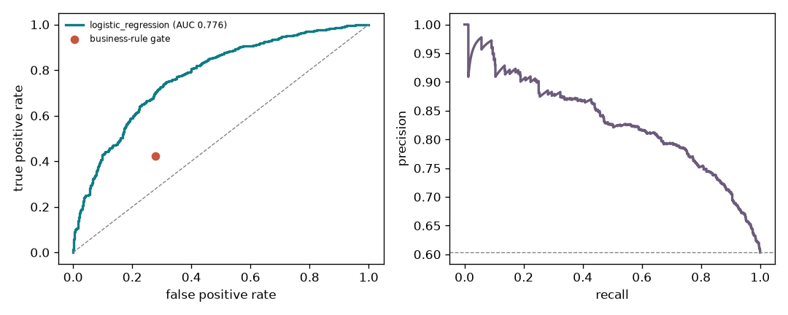
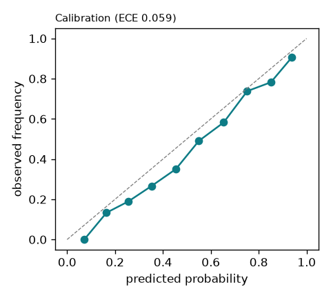
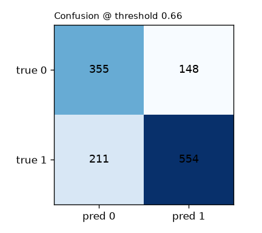
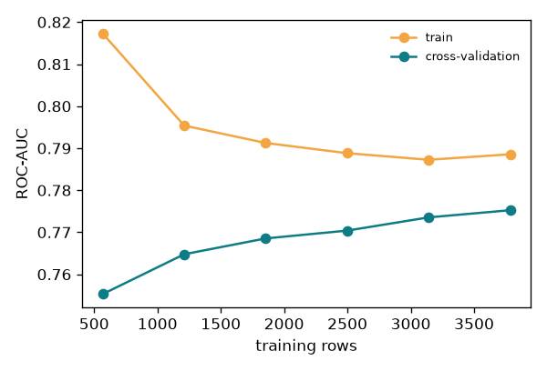
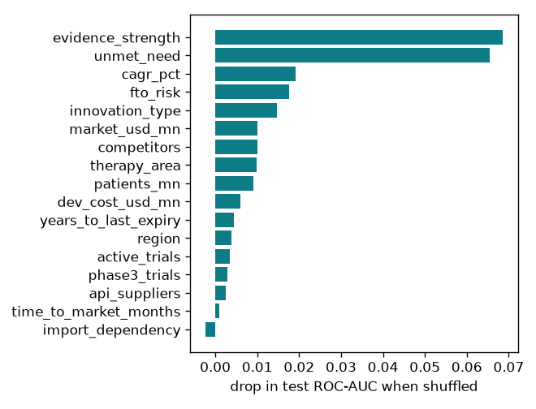

# Model report: repurposing opportunity scorer

Trained 2026-11-14T16:45:37+00:00 · scikit-learn 1.9.1 · data sha256 `957dd735ea324f8a` · seed 42

## 1. Task
Binary classification: will a repurposing project launch successfully? The output is a **calibrated probability**
shown to users next to the business-rule decision, plus the top drivers.

## 2. Data and split
- Dataset: see [`data/DATASET_CARD.md`](../data/DATASET_CARD.md). EDA: [`eda.md`](eda.md).
- Split: **out-of-time: test = assessment_year >= 2023**. Train 4732 rows (positive rate 65.9%),
  test 1268 rows (positive rate 60.3%).
- Files: `data/processed/train.csv`, `data/processed/test.csv`, `data/processed/expected_test_predictions.csv`.

## 3. Preprocessing and feature engineering (`features.py`)
| Stage | Fitted on | What |
|---|---|---|
| `clean` | n/a (stateless) | dedupe, sentinel → NaN, ×100/×1000 unit fixes, range checks, category normalisation, leakage and ID drop |
| `FeatureEngineer` | n/a | log market/patients/cost, burden per competitor, 5-year projected market, IP window open, phase-3 share, single-source supply risk, need × evidence, market per dev-cost |
| Impute + indicators | train folds | median imputation + missing-indicator columns |
| Winsorise | train folds | clip to the 1st/99th percentile |
| Scale / one-hot | train folds | StandardScaler (linear model); one-hot with an infrequent-category bucket, unknown-safe |

## 4. Model selection (stratified 5-fold CV on training years, ROC-AUC)
| model | CV AUC | CV train AUC | best params |
|---|---|---|---|
| logistic_regression | 0.7752 ± 0.0130 | 0.7886 | `{"C": 0.035506214270707714, "class_weight": "balanced"}` |
| hist_gradient_boosting | 0.7664 ± 0.0090 | 0.9270 | `{"max_leaf_nodes": 31, "max_iter": 150, "max_depth": null, "learning_rate": 0.03, "l2_regularization": 5.0}` |
| random_forest | 0.7596 ± 0.0115 | 0.8810 | `{"n_estimators": 400, "min_samples_leaf": 10, "max_features": "sqrt", "max_depth": 8}` |

Best CV model: **logistic_regression**. Chosen with the one-standard-error rule: **logistic_regression**.
The simplest model within one standard error of the best is preferred because it is easier to explain and more stable.
Calibration: sigmoid (5-fold). Decision threshold **0.660** (min expected cost (FP=2, FN=1) on out-of-fold train predictions).
Why cost-based: with a ~65% base rate, a max-F1 threshold labels almost everything a success (the always-yes
dummy already scores F1 ≈ 0.75). Funding a project that fails costs more than missing one, so false GOs are
weighted 2:1. MCC and balanced accuracy are reported because, unlike F1, they don't reward the dummy.

## 5. Held-out test results (evaluated once)
| metric | model | business-rule gate | prior-only dummy |
|---|---|---|---|
| ROC-AUC | **0.7759** (95% CI 0.752–0.802) | 0.5726 | 0.5000 |
| PR-AUC | **0.8298** | n/a | 0.6030 |
| F1 | **0.7553** | 0.5273 | 0.7526 |
| Precision / Recall | 0.789 / 0.724 | 0.698 / 0.424 | n/a |
| MCC | **0.4231** | 0.1475 | 0.0000 |
| Balanced accuracy | **0.7150** | 0.5726 | 0.5000 |
| Decision cost (2×FP + FN) | **507** | 721 | 1006 |
| Brier | 0.1898 | n/a | 0.2425 |
| Log-loss / ECE | 0.5617 / 0.0594 | n/a | n/a |

Confusion matrix: TN 355, FP 148, FN 211, TP 554.
Over-fit check: calibrated train AUC 0.7871 vs test 0.7759 (gap +0.0112).

 

## 6. Diagnostics

The train and CV curves converge as data grows, so more data gives diminishing returns. The remaining error is
mostly label noise, not variance.

### Permutation importance on test (drop in ROC-AUC)
| feature | importance |
|---|---|
| evidence_strength | +0.0686 |
| unmet_need | +0.0655 |
| cagr_pct | +0.0192 |
| fto_risk | +0.0176 |
| innovation_type | +0.0147 |
| market_usd_mn | +0.0101 |
| competitors | +0.0100 |
| therapy_area | +0.0099 |
| patients_mn | +0.0091 |
| dev_cost_usd_mn | +0.0061 |

## 7. How it is used in the product
`predict.py` validates inputs against a Pydantic contract, fills fields the agents could not observe with training
medians or modes (reported back as `imputed_fields`), and returns the probability, the thresholded label and local drivers.
The LangGraph `scorer` node shows it **next to** the rule gate. It is decision support, not an autonomous decision.

## 8. Limitations
Synthetic training data with a known generating process, so absolute numbers show the workflow is sound, not real-world
accuracy. Retrain on real portfolio outcomes with the same pipeline (`python -m repurpora.ml.train`). Monitor drift
on `assessment_year`.
