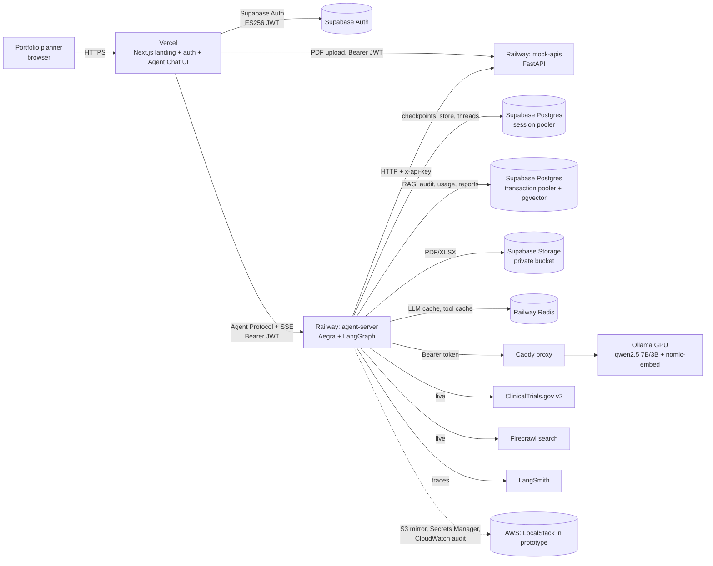

# Architecture

## System context



Today `P` and `O` are a local GPU behind a Cloudflare tunnel; in production they move to an EC2 g4dn.xlarge
(`infra/aws/ec2_ollama.sh`). The Caddy config is identical in both, so the switch is just a change to `OLLAMA_BASE_URL`.

## LangGraph topology

```mermaid
flowchart TD
  S((START)) --> C[compact<br/>context compaction]
  C --> G{guard_input<br/>injection / harmful / scope}
  G -- blocked --> E((END))
  G --> ML[memory_load<br/>user facts w/ provenance]
  ML --> PL{planner = Master agent<br/>structured ResearchPlan}
  PL -- chit-chat --> E
  PL -- follow-up --> FU[follow_up] --> E
  PL -- "Send × N (parallel)" --> W1[iqvia] & W2[exim] & W3[patent] & W4[clinical_trials] & W5[internal RAG] & W6[web]
  W1 & W2 & W3 & W4 & W5 & W6 --> EM[evidence_merge<br/>dedupe, E# ids, sha256]
  EM --> SC[scorer<br/>rules + ML p(success)]
  SC --> SY[synthesizer<br/>cited brief]
  SY --> J{judge<br/>coverage, citation acc., faithfulness}
  J -- "coverage < 0.75 (≤1 redraft)" --> SY
  J --> RP[report<br/>PDF + XLSX, archive, optional HITL interrupt]
  RP --> FN[finalize<br/>tables, evidence, DLP]
  FN --> MW[memory_write] --> E
```

## Design decisions

| Decision | Choice | Why |
|---|---|---|
| Orchestration | LangGraph `StateGraph` + `Send` fan-out + `Command` routing | Deterministic state machine. The LLM proposes and code decides, so the planner cannot skip the guard or the judge. |
| Agent server | Aegra (open-source Agent Protocol server) | Compatible with Agent Chat UI. Threads and checkpoints persist in our own Postgres, and there's no vendor licence. |
| Workers | Deterministic tool execution + fast-model notes | Small local LLMs are unreliable at multi-step ReAct. Data stays exact and the LLM only interprets it. |
| LLM | Self-hosted Ollama (qwen2.5 7B/3B) | Data residency (no third-party LLM APIs). Model routing: 7B for planning and writing, 3B for notes and judging. |
| RAG | pgvector HNSW + FTS → RRF (k=60) → MMR → corrective gate | Hybrid retrieval catches exact drug names that dense search misses. The gate prevents grounding on noise. |
| Evidence | `[E#]` citations, provenance hash, coverage gate | Measurable groundedness: coverage = supported claims / total claims. |
| ML | Logistic regression vs RF vs GBM with CV model selection | Complements the rule gate with a calibrated probability and explainable drivers. |
| Archive | Supabase Storage + reports table, with an S3 mirror | Satisfies the PS archival requirement. Signed URLs expire after 7 days. |
| AWS | LocalStack emulator in the prototype | Same boto3 and CLI code paths. Production is a configuration change. |
