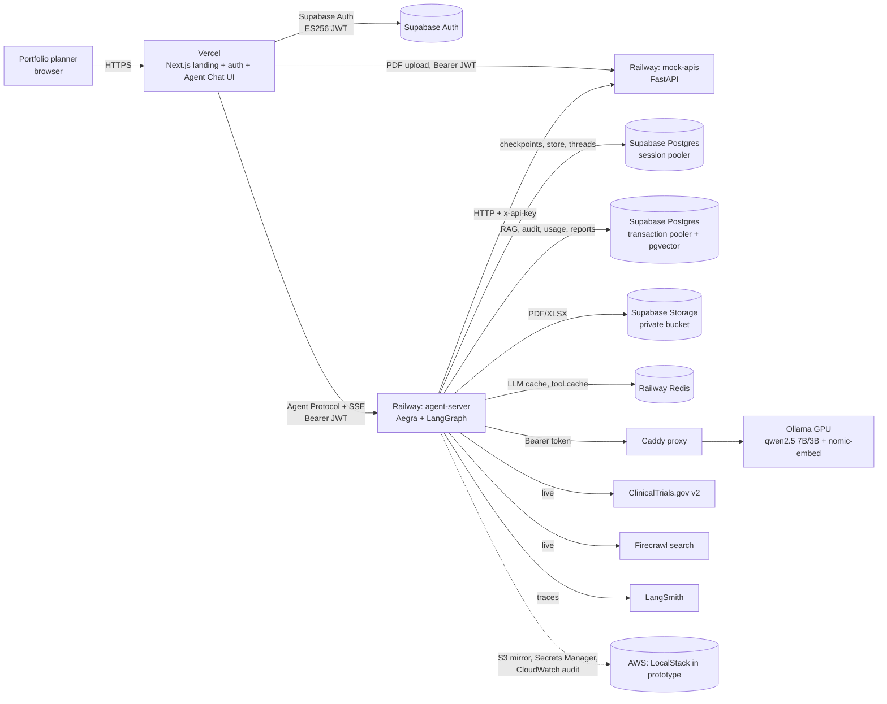

# Architecture

## System context



Today `P` and `O` are a local GPU behind a Cloudflare tunnel; in production they move to an EC2 g4dn.xlarge
(`infra/aws/ec2_ollama.sh`). The Caddy config is identical in both, so the switch is just a change to `OLLAMA_BASE_URL`.

## LangGraph topology

```mermaid
flowchart TD
  S((START)) --> C[compact<br/>context compaction]
  C --> G{guard_input<br/>injection / harmful / scope}
  G -- blocked --> E((END))
  G --> ML[memory_load<br/>user facts w/ provenance]
  ML --> PL{planner = Master agent<br/>structured ResearchPlan}
  PL -- chit-chat --> E
  PL -- follow-up --> FU[follow_up] --> E
  PL -- archive question --> SQ[sql_agent<br/>read-only, user-scoped text-to-SQL] --> E
  PL -- "Send × N (parallel)" --> W1[iqvia] & W2[exim] & W3[patent] & W4[clinical_trials] & W5[internal RAG] & W6[web]
  W1 & W2 & W3 & W4 & W5 & W6 --> EM[evidence_merge<br/>dedupe, E# ids, sha256]
  EM --> SC[scorer<br/>rules + ML p(success)]
  SC --> SY[synthesizer<br/>cited brief]
  SY --> J{judge<br/>coverage, citation acc., faithfulness}
  J -- "coverage < 0.75 (≤1 redraft)" --> SY
  J --> RP[report<br/>PDF + XLSX, archive, optional HITL interrupt]
  RP --> FN[finalize<br/>tables, evidence, DLP]
  FN --> MW[memory_write] --> E
```

## Memory layer

| Layer | Scope | Store | Notes |
|---|---|---|---|
| Short-term (session) | one thread | Aegra Postgres checkpointer | full message and state history, time travel, thread list in the UI |
| Context compaction | one thread | state `summary` | older turns summarised once the token budget is exceeded |
| Long-term facts | one user | LangGraph Store `("users", uid, "memories")` | one fact per molecule × indication, provenance (thread, report), **versioned** history (max 5), hard cap 40, `stale` flag after 30 days |
| User profile | one user | Store `("users", uid, "profile")` | learned usual region and recurring molecules; it becomes the planner's default region |
| User control | one user | planner commands | "what do you remember?" lists everything; "forget my history" erases it, and the erasure is audited |

## Archive SQL agent (text-to-SQL over the user's own reports)

Questions like *"list my GO reports for metformin"* or *"how many tokens did my sessions use this week?"* are
routed (regex fast-path, or the LLM planner's `archive_query` intent) to `sql_agent`.

| Layer | Control |
|---|---|
| What the LLM sees | Only two virtual tables, `my_reports` and `my_usage`, never real table names |
| Application validator | Single SELECT; no DML/DDL, comments or `;`; physical and schema-qualified names rejected (comma joins, subqueries, UNIONs included); LIMIT capped at 50 |
| Query wrapper | Server-side CTEs bind the virtual tables to `owner = %(owner)s` (a bound parameter) |
| Database | `SET LOCAL ROLE archive_reader`: column-level SELECT grants on `reports`/`llm_usage` only, and **RLS** policies keyed on a transaction-local `repurpora.owner`. Even raw SQL can't read another user's rows, and `audit_log` is denied. |
| Execution | READ ONLY transaction, 5 s statement timeout |
| Fallback | Deterministic template queries when the LLM is down or its SQL is rejected |
| Transparency | The SQL that ran is shown to the user in a collapsible block; each query is audited |

## ML opportunity scorer pipeline

`dataset.py` → `eda.py` → `features.py` → `train.py` → `predict.py`. The full write-up is in
[`backend/src/repurpora/ml/reports/model_report.md`](../backend/src/repurpora/ml/reports/model_report.md).

| Step | Detail |
|---|---|
| Split | out-of-time (test = assessments from 2023 on) |
| Preprocessing | fitted inside the sklearn Pipeline on training folds only |
| Model selection | baselines (prior dummy + the business-rule gate), RandomizedSearchCV over 3 model families, one-standard-error choice |
| Calibration | sigmoid |
| Threshold | cost-sensitive (FP = 2, FN = 1), chosen on out-of-fold training predictions |
| Test | single held-out evaluation with a bootstrap CI |
| Regression guard | the shipped model must reproduce `expected_test_predictions.csv` |

## MCP server (external tool contract)

The worker agents call tools **in-process**; MCP is only the outward-facing contract, so internal calls pay no protocol
hop. `repurpora/mcp_server.py` publishes 9 read-only tools over Streamable HTTP (`/mcp` on the aux service). The
server is an OAuth 2.1 **resource server**: Supabase is the authorization server, bearer tokens are verified via JWKS,
the scope is `repurpora:read`, and RFC 9728 protected-resource metadata is served. User-scoped tools
(`internal_knowledge`, `my_reports`) use the token's `sub`. Every call is audited. Host-header checks guard against DNS rebinding.

## Admin panel and runtime config

```
/admin (Next.js) ──Bearer JWT──► aux service /admin/* ──require_admin (app_metadata.role == "admin")
                                     │  overview: llm_usage, reports, audit_log aggregates
                                     │  config: app_config (+ app_config_history) ──► runtime_config.get() (15 s TTL)
                                     │                                               ──► graph: models, temperature, coverage gate,
                                     │                                                   redrafts, HITL gate, disabled agents, kill switch
                                     │  agents and RAG: allow-lists, rag_documents (delete)
                                     │  users: Supabase admin API (role in app_metadata, ban_duration)
                                     └  audit: audit_log (filter by event)
```
Config changes are validated by a Pydantic contract, require a reason, are versioned, and every admin mutation is audited.
Admins can't demote or suspend themselves.

## Universal coverage

| Dimension | Behaviour |
|---|---|
| Any molecule | Curated profiles for 8 showcase molecules. Any other molecule gets candidate indications from **live ClinicalTrials.gov** conditions (deduplicated). |
| Any region | 11 canonical regions (India, US, EU, UK, China, Japan, Brazil, Africa, SE Asia, Middle East, Global) detected from free text. Scaled market tables. |
| Any LLM host | `LLM_PROVIDER=ollama` (self-hosted, default) or `openai` (any OpenAI-compatible API: vLLM, LM Studio, Groq, Together, OpenAI), so it can run without a GPU |
| Any language | Users can ask in any language. The planner works in English; the brief is written in the user's language. The English-only keyword scope check is skipped for non-Latin scripts. |

## Design decisions

| Decision | Choice | Why |
|---|---|---|
| Orchestration | LangGraph `StateGraph` + `Send` fan-out + `Command` routing | Deterministic state machine. The LLM proposes and code decides, so the planner cannot skip the guard or the judge. |
| Agent server | Aegra (open-source Agent Protocol server) | Compatible with Agent Chat UI. Threads and checkpoints persist in our own Postgres, and there's no vendor licence. |
| Workers | Deterministic tool execution + fast-model notes | Small local LLMs are unreliable at multi-step ReAct. Data stays exact and the LLM only interprets it. |
| LLM | Self-hosted Ollama (qwen2.5 7B/3B) | Data residency (no third-party LLM APIs). Model routing: 7B for planning and writing, 3B for notes and judging. |
| RAG | pgvector HNSW + FTS → RRF (k=60) → MMR → corrective gate | Hybrid retrieval catches exact drug names that dense search misses. The gate prevents grounding on noise. |
| Evidence | `[E#]` citations, provenance hash, coverage gate | Measurable groundedness: coverage = supported claims / total claims. |
| ML | Logistic regression vs RF vs GBM with CV model selection | Complements the rule gate with a calibrated probability and explainable drivers. |
| Archive | Supabase Storage + reports table, with an S3 mirror | Satisfies the PS archival requirement. Signed URLs expire after 7 days. |
| AWS | LocalStack emulator in the prototype | Same boto3 and CLI code paths. Production is a configuration change. |
